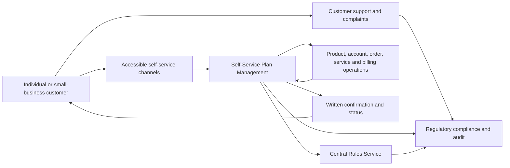
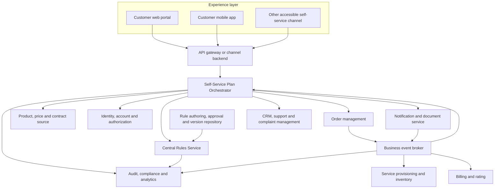
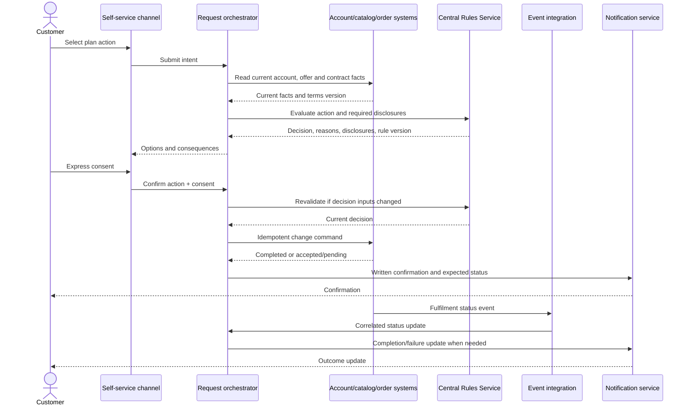

# Architecture Spine — CRTC 2026-78 Self-Service Plan Management

## Design Paradigm

API-led domain services with centralized policy decisioning and event-driven fulfilment. Customer journeys submit intent through a self-service orchestration boundary; one governed rules service evaluates shared business policy; domain systems retain ownership of customer, product, order, service, and billing data and execute their own state changes.

## Invariants & Rules

### AD-1 — Centralize shared self-service business decisions

- **Binds:** All plan-change and cancellation channels and product/service teams.
- **Prevents:** Different channels or applications applying inconsistent eligibility, disclosure, fee, consent, or cancellation rules.
- **Rule:** All channel-independent business decisions for self-service plan changes MUST be evaluated by the Central Rules Service. Each rule family MUST have one accountable business owner and one technical custodian; the governed rule repository is authoritative for the production rule version. The service MUST return a decision, reason codes, rule-set version, and required customer disclosures. It MUST NOT mutate customer, contract, order, provisioning, or billing state. Execution systems may enforce local technical and data-integrity invariants but MUST NOT independently redefine shared business policy. (CRTC 2026-78, paras. 12–16.)

### AD-2 — Domain systems own authoritative business records

- **Binds:** Customer/account, product/contract, order, provisioning, billing, and communications capabilities.
- **Prevents:** Conflicting records and competing writers for customer or service state.
- **Rule:** Each domain system remains authoritative for the records it owns and is the only writer of that domain state. The self-service orchestrator owns the lifecycle of the customer request, consent reference, and correlation ID—not the underlying customer account, contract, order, service, or bill.

### AD-3 — Orchestrate stateful journeys; separate decision from execution

- **Binds:** Interactive self-service flows and downstream plan-change fulfilment.
- **Prevents:** Channel-specific workflow logic, premature success responses, duplicate transactions, and inconsistent partial-failure handling.
- **Rule:** The Self-Service Plan Orchestrator MUST own the request lifecycle and coordinate channel-independent workflows. It MUST obtain a current rules decision before presenting eligible options and again before committing a confirmed action when decision inputs may have changed. State-changing commands MUST carry a unique request ID, a stable correlation ID, and an idempotency key. The canonical request states MUST be `RECEIVED`, `AWAITING_CONSENT`, `ACCEPTED`, `IN_PROGRESS`, `COMPLETED`, `REJECTED`, and `FAILED`; transitions MUST be monotonic and terminal outcomes MUST NOT be overwritten by retries. Apply a direct, synchronous fulfilment path by default so actions take effect immediately to the greatest extent possible. Use asynchronous fulfilment only where a domain dependency prevents immediate completion; disclose the expected timeframe and reason where known, keep status current, and send an outcome update. A live-representative handoff MUST be limited to additional information reasonably needed to clarify the customer’s intent; self-service MUST NOT make a representative interaction the routine prerequisite for these actions. (CRTC 2026-78, para. 13.)

### AD-4 — Preserve customer choice, consent, and outcome evidence

- **Binds:** All self-service actions, written confirmations, complaints, and compliance evidence.
- **Prevents:** A request being executed against terms the customer did not see or consent to, and inability to establish what was requested or completed.
- **Rule:** Before a state-changing command, the journey MUST present the resulting contract/plan changes and relevant ability to return to prior terms, then capture express consent tied to the exact offer/terms version and action. The orchestrator MUST retain a correlated, auditable record of the action, displayed disclosure/terms version, consent, decision reference, command, result, and confirmation status. Every action submitted through self-service MUST trigger written confirmation; the mechanism MUST disclose the expected delivery timeframe. The confirmation record MUST identify the requested action and accurately state whether it was received, accepted, completed, or failed, including the effective date when known. If fulfilment is asynchronous, communicate completion or failure when known. Compliance/privacy owners MUST approve the evidence fields and retention schedule before production. (CRTC 2026-78, paras. 14–15, 28–29.)

### AD-5 — Apply customer-service fee and accommodation controls consistently

- **Binds:** Digital channels, assisted support, fee configuration, and customer operations.
- **Prevents:** Access fees being charged through an alternative channel or customers requiring accommodations being left without a usable path.
- **Rule:** Customer-service access MUST NOT incur a fee. The fee decision MUST be classified separately from any charge for the requested service action and evaluated against applicable regulatory rules. Release acceptance MUST include tests showing that no channel or assisted-support path charges a customer-service access fee. Self-service journeys MUST be reviewed against existing accessibility and privacy obligations before release; an accommodation path MUST NOT rely exclusively on a live representative. (CRTC 2026-78, paras. 25–27, 30–31, 45.)

### AD-6 — Integrate through governed APIs and business events

- **Binds:** Channel-to-service, rules, domain, and notification integrations.
- **Prevents:** Point-to-point policy duplication, untraceable transactions, and silent divergence between synchronous responses and eventual outcomes.
- **Rule:** Customer-facing channels MUST access the orchestrator through a versioned API boundary. The orchestrator MUST use governed APIs for synchronous reads/commands and business events for asynchronous fulfilment status. All messages MUST include the canonical request ID, correlation ID, event/command type, UTC timestamp, and schema version; identifiers MUST retain their meaning across channels and domain adapters. Retries MUST be safe and duplicate commands MUST NOT create duplicate business actions. Failures MUST be observable, reconciled, and actionable by an owned operational queue.

### AD-7 — Operate the service as a regulated, recoverable capability

- **Binds:** Rules service, orchestration, integration, notifications, and compliance operations.
- **Prevents:** A single unavailable component, unreviewed rule change, or missing evidence blocking customers or preventing a defensible compliance response.
- **Rule:** Run-time components MUST be deployed redundantly across failure domains appropriate to the provider’s hosting environment; production rules MUST be versioned, approved, effective-dated, testable, and reversibly released. Before production, accountable business and operational owners MUST approve measurable service objectives, alert thresholds, escalation paths, and recovery targets for decisioning, fulfilment, and confirmations; retain actual values in operational runbooks, not in regulatory policy configuration. Monitor decision latency/errors, request age and completion, fulfilment latency/failures, confirmation delivery, and integration backlogs. Provide alerting, replay/reconciliation, disaster recovery, access control, and immutable or tamper-evident audit evidence. Do not silently fall back to stale or permissive rules when decisioning is unavailable. Environment and hosting technology remain implementation choices pending platform discovery.

## Business Architecture

### Business capability boundaries

- **Customer self-service:** Discover plan options; initiate upgrades, downgrades, service additions/removals, or cancellation; view request status.
- **Policy and eligibility decisioning:** Apply consistent business rules and return actionable decisions, reasons, and required disclosures.
- **Consent and request management:** Capture informed, express consent and manage request states from submission through outcome.
- **Service change fulfilment:** Execute accepted changes through existing product, order, provisioning, and billing operations.
- **Confirmation and support:** Send written receipts/outcomes and resolve exceptions or complaints without charging for customer-service access.
- **Compliance oversight:** Govern rules, monitor operational outcomes, retain evidence, and respond to CRTC inquiries.

The policy applies to all providers; the definition applies to individual and small-business customers. Enforcement begins 26 April 2027. The CRTC administers this requirement directly, rather than through the Wireless Code, Internet Code, or CCTS. (CRTC 2026-78, paras. 17, 35–39, 43–45.)

## Regulatory Traceability

| Regulatory obligation | Architecture coverage | Policy reference |
|---|---|---|
| Easy-to-use self-service for plan modifications and cancellations | Business capability boundaries; channel and orchestrator responsibilities | Paras. 13, 16–17, 42–43 |
| Informed, express consent and transparency of plan/contract consequences | AD-4; consent and contract source integrations | Paras. 14–15 |
| Immediate effect to the greatest extent possible; clarification only when reasonably needed | AD-3; synchronous fulfilment default and bounded representative clarification | Para. 13 |
| Written confirmation for every action and timeframe disclosed in the mechanism | AD-4; confirmation workflow and evidence | Paras. 28–29, 44 |
| No fee for access to customer service | AD-5; fee decision and release tests | Paras. 25–27, 44 |
| Existing accessibility and privacy protections apply; accessibility encouraged | AD-5; accessibility/privacy release review | Paras. 30–31, 45 |
| Applies to all service providers; direct Commission administration and enforcement date | Business architecture scope and deployment readiness | Paras. 35–39, 43 |

## Application Architecture

### Application responsibilities

- **Channels and API boundary:** Render accessible, secure customer journeys; do not embed authoritative eligibility, fee, or contract-change policy logic.
- **Self-Service Plan Orchestrator:** Own request/consent lifecycle, correlation, idempotency, state transitions, compensation/escalation decisions, and customer-visible status. It coordinates but does not become the master for domain records.
- **Rule authoring and approval:** Provide controlled, auditable configuration and promotion of rules, owned by designated business approvers and technical custodians.
- **Central Rules Service:** Evaluate versioned policy rules and return decisions with reason codes, disclosures, and rule version. Business rule owners approve policy meaning; the technical custodian publishes tested versions; each decision is traceable to both.
- **Domain applications:** Continue to own authoritative customer/account, product/contract, order, service/provisioning, and billing data and their state mutations.
- **Notification service:** Deliver written confirmations and, for asynchronous actions, later completion/failure status. Report delivery outcomes to the orchestrator.
- **Audit/compliance and case management:** Correlate requests and evidence; support complaints, operational monitoring, and regulatory inquiry.

## Integration Architecture

1. **Start and evaluate:** Customer authenticates; the channel sends an intent to the orchestrator. The orchestrator retrieves current account, product, contract, and eligibility facts from their authoritative systems, then requests a rules decision.
2. **Present and consent:** The channel presents available options, material contract consequences, applicable action charges, and relevant return-to-prior-terms information. Customer provides express consent tied to the terms and rule version shown.
3. **Revalidate and submit:** The orchestrator revalidates the decision when inputs may have changed, records consent and evidence, then submits an idempotent command to the order/domain system.
4. **Fulfil and reconcile:** Use synchronous fulfilment as the default. Where a domain constraint prevents immediate completion, record the reason and expected timeframe, publish lifecycle events, and update request status as order, provisioning, and billing systems complete. Use retry-safe commands, dead-letter/exception queues, reconciliation, and operational alerts.
5. **Confirm and support:** Send written confirmation for each submitted action and disclose the expected delivery timeframe in the mechanism. Confirmation must accurately state whether the request is received, accepted, pending, completed, or failed, and include the selected action and effective date when known. Send an outcome update when asynchronous fulfilment completes or fails. Keep correlated evidence available to support and compliance.

## Centralized Rules Service Recommendation

**Recommendation:** Establish a centralized, logically authoritative **Central Rules Service** as the policy decision point for shared business rules governing self-service plan changes and cancellations. This addresses the current distribution of rules across applications without requiring an immediate replacement of existing systems.

### Rules that belong in the service

- Customer/account and service eligibility for an action.
- Allowed action types and plan-change constraints across channels.
- Required disclosures, consent prerequisites, and contract consequence indicators.
- Policy decisions distinguishing customer-service access fees from permitted action-related charges under applicable rules.
- Clarification requirements where customer intent is not sufficiently clear.
- Effective dates, applicability, and versioned policy configuration.

### Rules that remain in domain systems

- System-specific data validation and integrity constraints.
- Order acceptance and fulfilment mechanics.
- Provisioning/network feasibility and billing execution.
- Authentication and authorization enforcement at each protected boundary.

### Design and governance

- Treat it as a decision service, not a workflow engine or master-data store.
- Use a stable, versioned decision API. Inputs should reference authoritative facts or carry explicit timestamps/versions; outputs should include outcome, reason codes, required disclosures, rule-set version, and decision reference.
- Keep decisions deterministic for the same rule version and input facts. Give each rule family one accountable business owner and technical custodian. Make policy changes effective-dated and auditable; require business owner approval and automated regression tests before production activation.
- Avoid direct point-to-point calls from every channel into a rules engine. Route business journeys through the orchestrator, which owns transaction context and obtains decisions.
- During migration, inventory rules, assign an accountable business owner and authoritative source for each, map duplicates/conflicts, and route one rule family at a time through the service. Run shadow comparisons before switching enforcement; then remove or disable duplicate policy implementations. Do not retain divergent “temporary” rules without an owner, expiry, and reconciliation plan.
- Design for horizontal scale, high availability, bounded response time, observable decisions, and graceful failure. For actions affecting customer contracts or charges, do not silently fall back to stale or permissive local policy when the service is unavailable; return a safe retry/temporary-unavailable outcome and provide a clear customer status path.
- Define and approve the rule decision contract, canonical identifiers, reason-code catalogue, request lifecycle state model, and confirmation message fields before teams build independent channel or domain adapters.

## Consistency Conventions

| Concern | Convention |
|---|---|
| Requests and events | `requestId` uniquely identifies one submitted customer action; `correlationId` traces all processing of that action; the idempotency key remains unchanged on retries; `eventId` uniquely identifies an event. Carry provider-native customer/account/service references, action type, schema version, and UTC `occurredAt`. Do not put unnecessary personal information in event payloads. |
| Decision evidence | Persist decision reference, rule-set version, reason codes, input fact references/versions, consent reference, and outcome against the request lifecycle. |
| State ownership | Orchestrator owns request lifecycle; domain services own domain records. No shared database writes across service boundaries. |
| API and event evolution | Version contracts; make additive compatible changes by default; publish owners and consumer expectations. |
| Errors and retries | Use explicit machine-readable error categories and customer-safe messages. Commands are idempotent; retryable and terminal outcomes are distinct. |
| Security and privacy | Apply least privilege, strong customer/account authorization, encryption in transit and at rest, auditable administrative changes, and data minimization consistent with existing obligations. |
| Rule changes | Require named business owner, approval, effective date, version, tests, release history, and rollback path. |

## Deployment & Operations

- Deploy the channel boundary, orchestrator, rules decision service, event integration, and notification capability across redundant failure domains in the provider’s approved hosting environment; no cloud or vendor is selected by this spine.
- Maintain isolated development, test, pre-production, and production environments with controlled promotion of rule versions and API/event contracts.
- Operate dashboards and alerts for rules-service availability/latency, decision errors, request age and status, fulfilment failures, event backlog, duplicate/rejected commands, and confirmation delivery.
- Establish operational ownership and runbooks for unavailable rules decisions, delayed/failed fulfilment, notification failure, replay/reconciliation, customer remediation, and complaint evidence retrieval.
- Define recovery objectives, backups, audit retention, capacity targets, and security controls through the provider’s enterprise standards and regulatory/legal review.
- Enforcement begins 26 April 2027; schedule integration testing, accessibility/privacy assessment, operational rehearsal, and customer-journey validation ahead of that date.

## Capability → Architecture Map

| Capability | Lives in | Governed by |
|---|---|---|
| Customer self-service for plan management | Channels, API boundary, Self-Service Plan Orchestrator | AD-1, AD-3, AD-5, AD-6 |
| Plan change and cancellation fulfilment | Orchestrator and domain order/provisioning/billing systems | AD-2, AD-3, AD-6 |
| Informed consent and contract transparency | Channel journey, orchestrator, Central Rules Service, contract/product source | AD-1, AD-4 |
| Written confirmation and interaction evidence | Orchestrator, event integration, notification, audit/compliance | AD-4, AD-6, AD-7 |
| Customer-service fee governance | Central Rules Service, channel/support, fee catalogue and billing | AD-1, AD-5 |
| Accessible and privacy-respecting delivery | All customer-facing and data-processing components | AD-5, AD-7 |
| Regulatory compliance and complaint readiness | Compliance/audit, case management, service observability | AD-4, AD-7 |

## Assumptions

- The provider operates existing customer, product/contract, order, provisioning, billing, and customer-support systems that can be integrated or adapted; no inventory was supplied.
- Individual and small-business customer journeys are in scope. Applicability to complex larger-business arrangements will be confirmed with regulatory/legal owners.
- The target is a logical architecture. No cloud, vendor, programming language, API gateway, event broker, rules product, or system of record is selected.
- The no-fee rule concerns access to customer service; action-related charges must be validated against other applicable CRTC determinations.
- Written confirmation plus a subsequent outcome update for asynchronous fulfilment is the recommended design; the policy requires written confirmation for every action and timeframe disclosure but does not prescribe a message protocol.

## Open Questions

- Which current applications, databases, and teams own customer identity/account, product/price, contract terms, eligibility, orders, provisioning, and billing?
- What integration, hosting, identity, security, observability, and data-retention standards are already approved?
- Which business rules are duplicated, conflicting, or customer/channel specific, and who will own their consolidated definitions?
- What response-time and availability objectives can the provider support for decisioning and customer-visible status?
- Which self-service channels and accessible alternatives will be in scope for launch?
- Which business decisions and fee rules require legal/regulatory approval, including treatment of existing action-related charges?
- What written-confirmation content and expected timeframe will be selected for synchronous and asynchronous actions?
- What evidence retention and operational reporting requirements will regulatory affairs establish?
- What is the migration sequence and business fallback if a domain system cannot fulfil a request immediately?

## Deferred

- Product/vendor selection, technology stack, cloud/provider topology, physical deployment diagrams, and numeric service-level objectives: defer until platform inventory, enterprise standards, and volumes are known.
- Detailed API/event schemas and domain data models: defer to solution and interface design, preserving the invariants above.
- Customer journey wireframes and accessibility acceptance criteria: defer to UX and accessibility discovery under existing obligations.
- Exact action-fee eligibility and billing policy: defer to legal/regulatory review of applicable CRTC decisions.
- Detailed controls, retention schedules, and regulator response procedures: defer to compliance, privacy, security, and records-management owners.
